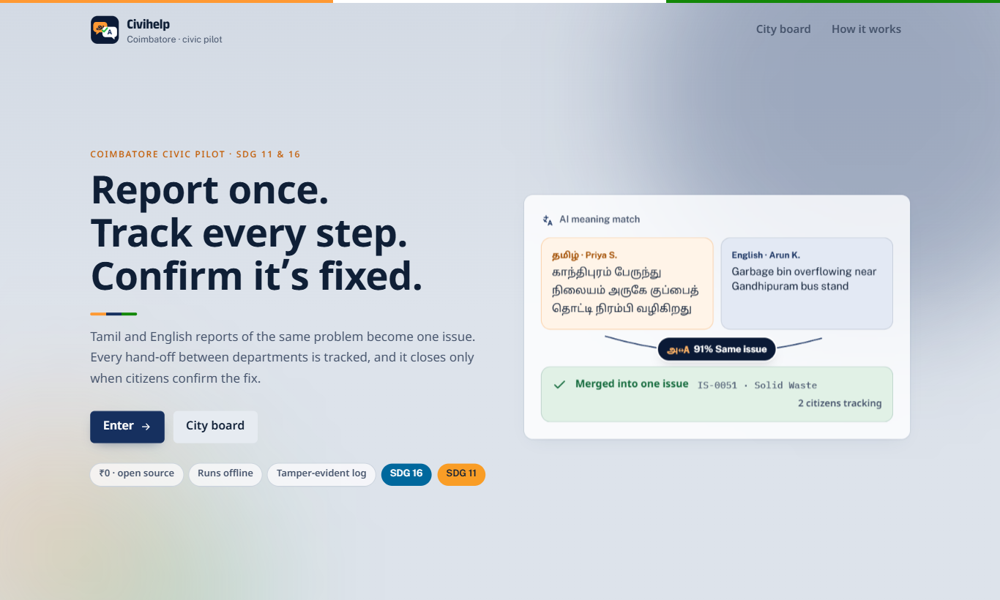
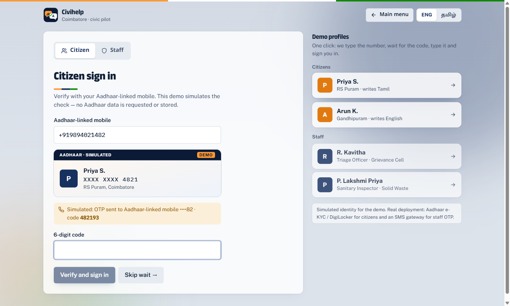
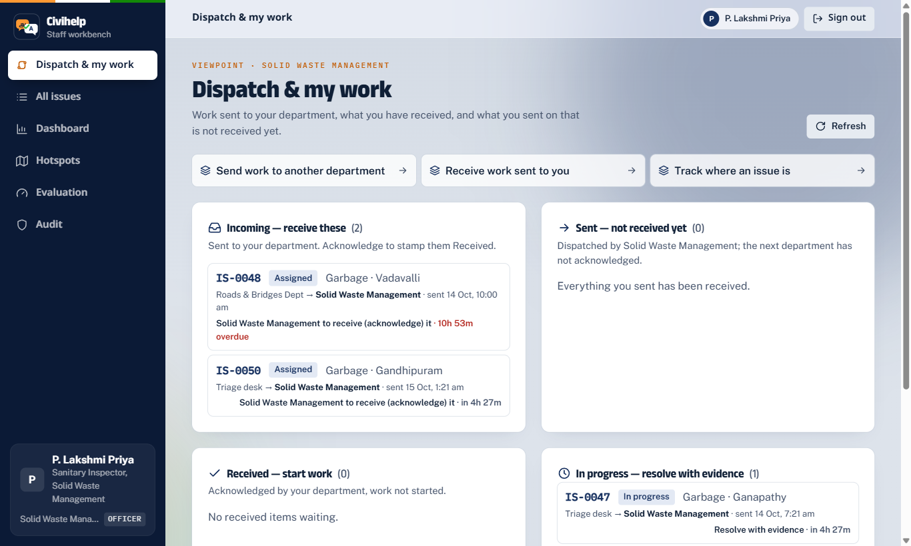
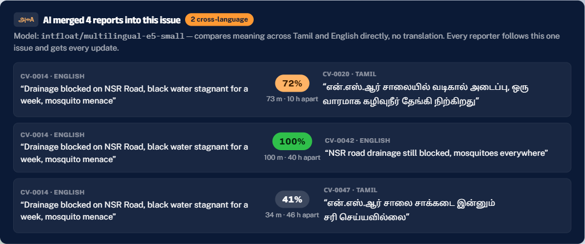
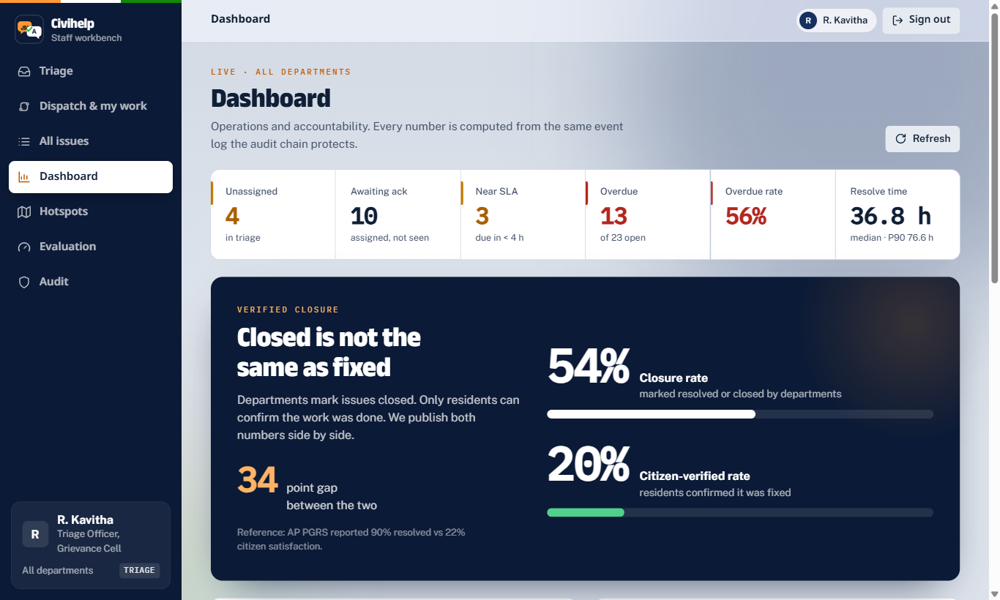

# Civihelp

**Report once. Track every step. Confirm it’s fixed.**
Civic complaint routing, dispatch tracking and citizen-verified closure for Indian cities. Pilot: Coimbatore, English + தமிழ்.

Built in 12 hours at **CODE VAULT 2026** (KPRIET × GeeksforGeeks), 14 Oct 19:00 → 15 Oct 07:00 IST. SDG 16 (16.6, 16.7) · SDG 11.



---

## The problem

> Citizens file duplicate complaints; complaints have no clear owner, bounce between departments, get closed without work being done, and nobody is accountable for overdue cases.

- Andhra Pradesh PGRS: **90%** of complaints officially "resolved" vs **22%** citizen satisfaction (The Wire).
- BMC Mumbai: only **414 of 13,552** escalated complaints resolved (Praja Foundation).
- No deployed Indian system links a Tamil report and an English report of the same problem.

## What Civihelp does

| Problem | Civihelp |
|---|---|
| Duplicates, across languages | A local multilingual AI model compares the **meaning** of Tamil and English reports (no translation), plus distance and time. Matching reports merge into one issue that **every reporter tracks**. |
| No clear owner | Versioned routing rules + Tamil/English keywords + ward coverage → top-3 departments with a **confidence tier and plain reasons**. Low confidence goes to a person. |
| Bouncing between departments | A **dispatch trail** shows every hop as *Sent* and *Received* (acknowledged), with department, time, officer and next step. Rejecting needs a reason and a new owner; bounces are counted publicly. |
| Closed without work | Resolving needs a closure reason + evidence. The issue closes only when **30% of its reporters confirm** the fix; any one of them can reopen it. Closure rate vs citizen-verified rate are published side by side. |
| No accountability for overdue | Every issue has a due time and the reason for it; overdue issues auto-escalate to a supervisor; a public **City Board** ranks departments. |
| Trust | Every status change is written to a **SHA-256 hash-chained, append-only audit log**. Edit a row in the database and verification fails on screen. |

### Measured, not claimed (live Evaluation page, 120 labelled synthetic reports)

| Metric | Result |
|---|---|
| Duplicate linking, pairwise F1 — multilingual-e5-small | **0.85** |
| Duplicate linking, pairwise F1 — TF-IDF baseline | 0.26 |
| Routing top-1 accuracy | **93.5%** |
| Also shown | Top-3, macro-F1, confusion matrix, B-cubed F1, Recall@5, median/P90 resolve time, overdue rate |

*Synthetic data for a fictional pilot — not real-world results.*

## Screens

| | |
|---|---|
|  **Demo login** — 4 one-click profiles; citizens use a simulated Aadhaar check, staff the real OTP flow |  **Dispatch & my work** — incoming, received, in progress, sent-not-received |
|  **AI match panel** — why these reports are one issue |  **Dashboard** — closed vs citizen-verified gap |

## Run it locally

Requirements: Python 3.12, Node 20+.

```bash
# 1. Backend
cd backend
python -m venv .venv
.venv/Scripts/pip install -r requirements.txt --extra-index-url https://download.pytorch.org/whl/cpu   # macOS/Linux: .venv/bin/pip
# 2. AI model (~470 MB, one time; without it the app falls back to TF-IDF)
.venv/Scripts/python -c "from sentence_transformers import SentenceTransformer; SentenceTransformer('intfloat/multilingual-e5-small').save('models/e5-small')"
# 3. Demo data
.venv/Scripts/python seed.py
# 4. Frontend build
cd ../frontend && npm install && npm run build
# 5. Serve app + API on http://localhost:8000
cd .. && backend/.venv/Scripts/python -m uvicorn app:app --app-dir backend --port 8000
```

Tests: `cd backend && .venv/Scripts/python -m pytest -q` (40 tests).
Dev mode with hot reload: run step 5, then `cd frontend && npm run dev` (proxies `/api` to :8000).

## Demo walkthrough (3 min)

1. Loading screen → landing → **Enter** → main menu; switch to **தமிழ்**.
2. **Citizen login → Priya S.** (simulated Aadhaar) → *தமிழ் மாதிரி* sample → Submit → tracking ID.
3. Sign out → **Arun K.** → *English sample* → "Already reported nearby — Tamil ↔ English" → **Follow this issue**.
4. **Staff login → P. Lakshmi Priya** (number and OTP typed for you; *Skip wait* to hurry) → *Dispatch & my work* → Incoming → open the issue → **AI match panel** and **dispatch trail** → Acknowledge (*Received*) → Mark resolved with evidence.
5. Track Priya's report → `0 / 1 confirmations` → **Yes, it is fixed** → Closed (citizen-verified).
6. **R. Kavitha** (triage) → Triage queue with routing reasons → Audit → Verify chain → run `backend/.venv/Scripts/python backend/tamper.py` → Verify fails at the edited event.
7. Dashboard (closed vs verified gap), Hotspots map, Evaluation metrics.

### Demo profiles (all fictional)

| Profile | Type | Number | Access |
|---|---|---|---|
| Priya S. | Citizen (RS Puram, Tamil) | +91 98940 21482 · Aadhaar XXXX XXXX 4821 (mock) | Report, track, confirm/reopen |
| Arun K. | Citizen (Gandhipuram, English) | +91 99430 17356 · Aadhaar XXXX XXXX 7356 (mock) | Report, track, confirm/reopen |
| R. Kavitha | Staff · Triage Officer | +91 90000 00001 | Triage, route, link duplicates, dashboards, audit |
| P. Lakshmi Priya | Staff · Solid Waste officer | +91 90000 00003 | Own department's work: receive, resolve, send on |

Other staff in `backend/seed.py` (+91 90000 000xx): Roads, Electrical, Drainage, Water officers, a supervisor and an admin. Staff numbers are refused at citizen login; citizens cannot open staff pages. Reporting, tracking and confirming require a citizen session issued by the server (anti-spam): one confirmation vote per citizen, max 10 reports per citizen per hour.

## Architecture

```
frontend/  React 19 + Vite + Tailwind 4 · React Router · Leaflet (OSM) · Recharts · GSAP
  src/pages      Landing, Menu, Login, Report, Track, Board, About, staff pages (Triage, Dispatch, Issues, IssueDetail, Dashboard, Hotspots, Evaluation, Audit)
  src/shell.jsx  one sidebar + top-bar shell (light = citizen, navy = staff)
  src/dispatch.jsx  dispatch trail + how-to guides
backend/   FastAPI + SQLite (stdlib)
  engine.py      routing rules, Tamil/English keywords, multilingual-e5-small duplicates (TF-IDF fallback)
  workflow.py    state machine, role permissions, deadlines, escalation, dispatch trail, 30% confirmation quorum
  auth.py        directory-only staff login, hashed OTP (5 min, 3 tries, 30 s resend, lockout), signed 8 h sessions
  db.py          schema, append-only triggers, SHA-256 hash chain
  metrics.py     evaluation metrics · seed.py labelled demo data · tamper.py audit-chain demo
```

API reference: [`docs/API.md`](docs/API.md). Product spec: [`PRD.md`](PRD.md). Build log: [`docs/BUILD_PLAN.md`](docs/BUILD_PLAN.md).
Interop: `GET /open311/requests.json` (Open311-style).

## Limitations and future work

- Identity is simulated: real deployment would use Aadhaar e-KYC / DigiLocker for citizens and an SMS gateway (NIC/CDAC, MSG91) behind the existing `send_sms()` for staff OTP.
- Per-citizen rate limiting, machine translation, voice intake, image similarity, full State → District → ULB hierarchy, DPDP review, live government integration.
- Data, wards, staff and reports are fictional.

## Credits and disclosure

Built within the event window by the team, with AI assistance, disclosed in full as the rules require.

**AI tools**
- **Claude Code (Anthropic) — main model Claude Opus 5.5** — wrote most of the code, tests, docs and this README under the team's direction and review, in the Claude desktop app.
  - **AI sub-agents** launched by Claude Code: Claude Opus 5.5 (10 runs) and Claude Sonnet 5.5 (1 run) — research, parallel build, Explore/general-purpose code search, and review agents from the *agent-skills* plugin (code-reviewer, security-auditor, test-engineer).
  - **Plugins / skills:** frontend-design, remember, Playwright, agent-skills, ponytail; built-in browser skill.
  - **Tools:** Claude's built-in browser and Claude in Chrome (UI checks), Playwright (end-to-end tests and README screenshots), Claude Docs (planning notes), Claude visualize widget (logo and loader options shown to the team).
- **ChatGPT (OpenAI)** — early brief / problem framing.
- **intfloat/multilingual-e5-small** (Hugging Face, MIT licence) — the duplicate-matching model, run locally on CPU.

**Libraries and services**
- Backend: FastAPI, Uvicorn, Pydantic, sentence-transformers, Transformers, PyTorch (CPU), NumPy, scikit-learn, pytest, HTTPX.
- Frontend: React, React DOM, React Router, Vite, Tailwind CSS, Leaflet, React-Leaflet, Recharts, GSAP + @gsap/react, oxlint.
- Map tiles: © OpenStreetMap contributors. Fonts: Public Sans, Anek Latin, Noto Sans Tamil, IBM Plex Mono (Google Fonts).

**Research sources** — The Wire (AP PGRS satisfaction survey), Praja Foundation (BMC complaints), public documentation of CPGRAMS, Swachhata, Namma Chennai, Namma Kovai, BBMP Sahaaya, FixMyStreet, NYC311, Singapore OneService, Denver 311.

Cost: ₹0 — no paid APIs.
